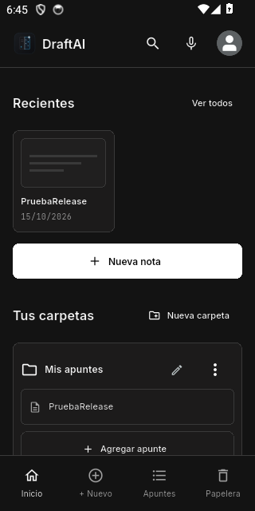

# DraftAI
DraftAI es una aplicación para crear y organizar notas con texto e imágenes. Guarda tus apuntes en el dispositivo, agrúpalos en carpetas y categorías, encuentra lo que necesitas y exporta tus notas para compartirlas.

[Descargar APK firmado 0.2.0](https://github.com/Yuuki-2026/DraftAI/releases/tag/v0.2.0) · [Configuración de servicios](docs/CONFIGURATION.md) · [Continuidad](docs/PROGRESS.md)

Notas con formato, imágenes y cámara, carpetas/categorías, búsqueda y voz, historial, papelera y exportación PDF/Word/TXT/Markdown. Datos cifrados localmente. Gratis permite resúmenes y mejoras limitadas. La IA de prueba se conecta por dispositivo a un servidor temporal, sin Google; las claves de proveedor permanecen fuera del APK. Los planes no procesan pagos.

Captura de la primera entrega; en 0.2.0 se actualizó la interfaz y se omitieron nuevas capturas a petición del propietario.

## Entorno fijado
- Flutter **3.47.2**, Dart **3.13.2**, Java **17**.
- Android mínimo **8.0 / API 26**, compile/target **36**.
- iOS mínimo **15.0**; configuración preparada, requiere validación en macOS.
- Dependencias exactas en `pubspec.yaml`, resolución en `pubspec.lock`, SDK en `.fvmrc`.

## Ejecución
`flutter pub get`, `dart run build_runner build`, `flutter run`.

## Desarrollo y continuidad
Consultar `docs/PROGRESS.md`, `docs/ARCHITECTURE.md` y `docs/TESTING.md` antes de continuar. El material `Contexto/` es referencia local y no se modifica ni se publica.

## Servicios
Sin credenciales debe funcionar el modo invitado. La IA remota y Google requieren configuración: ver `docs/CONFIGURATION.md`. Los planes son demostrativos y no cobran dinero.

## Probar la versión 0.2.0
La instalación nueva empieza vacía. Perfil → Biblioteca de prueba permite cargar 20 notas ficticias con imágenes/PDF y eliminar solo esos ejemplos. Las instalaciones anteriores conservan sus notas.

En Herramientas de IA, conectar el servidor HTTPS con el código privado facilitado localmente. Texto: Groq `openai/gpt-oss-20b`; lectura de imágenes: Groq `qwen/qwen3.8-27b`, solo para dispositivos de prueba autorizados por el operador. La app realiza transformaciones de notas, no ofrece chat libre.

Ver docs/TEST_SERVER.md para iniciar/detener la conexión de prueba, modelos y límites. Google y pagos reales siguen pendientes.
