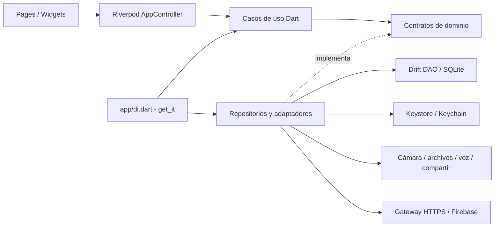

# Arquitectura y decisiones

## Regla de dependencias
Cada funcionalidad tiene domain, data y presentation. Domain solo usa Dart. Presentation depende de contratos y casos de uso. Data implementa los contratos. El ensamblaje de app/di.dart conoce las implementaciones; las pantallas no construyen plugins.

Persistencia: Drift/SQLite, DAO, mapeadores y transacciones. Las notas son locales, sin sincronización remota. Riverpod controla estados de carga, datos y errores. get_it configura repositorios y servicios. Reloj e identificadores se inyectan para pruebas deterministas.

## Seguridad
Datos operativos y preferencias en SQLite. Credenciales y claves en Keystore/Keychain mediante un único adaptador de flutter_secure_storage. Nunca claves privadas de proveedores de IA en el APK. Android sin backup automático ni tráfico HTTP. Se documentará qué datos se cifran y las limitaciones reales; no se afirmará cifrado de extremo a extremo.

## Modelo
Carpeta es la agrupación principal; categoría es una subdivisión opcional dentro de una carpeta; tema es un atributo del apunte. Una nota tiene una carpeta y opcionalmente una categoría. La IA propone, el usuario confirma. El invitado usa un espacio local que conserva su propiedad al salir. Google no sincroniza notas.

## Interfaz
Referencia canónica: Contexto/Mockup/mockup_screens e interfaz compartida mockup.css. Fondo #131313, superficies #1c1b1b/#201f1f, líneas #393939, texto #f5f5f5 y acentos blancos. Se conserva densidad, orden y navegación. Se completan crear nota, validaciones y estados. Puntos de quiebre: compacto <600, medio 600–839, expandido >=840; ancho de contenido limitado en páginas de formulario. SafeArea, teclado y escalado de texto reales del sistema.

## Referencias académicas
Clean_Architecture_SIS048_Unidad2.pdf, guía Semana 10 de persistencia y Semana 11 de seguridad. Se aplican patrones al dominio de apuntes; no se trasladan los ejercicios clínicos ni los antipatrónes de laboratorio.

## Grafo de dependencias

Los módulos externos conocen las entidades de apuntes cuando las necesitan, pero el dominio no conoce plugins ni widgets. No hay acceso SQL en las pantallas. Las implementaciones y el ensamblaje se sustituyen por dobles durante las pruebas.

## Persistencia y protección
| Tabla | Datos visibles para SQLite | Contenido protegido |
|---|---|---|
| folders | id | Nombre y color en payload AES-GCM |
| categories | id, folder_id | Nombre cifrado |
| notes | id, folder_id, category_id, fechas | Título, tema, texto, documento enriquecido, resumen y lista de adjuntos |
| revisions | id, note_id, fecha | Versión anterior y motivo cifrados |
| preferences | Clave y valor | Solo preferencias no sensibles y contadores demo |

Los adjuntos se almacenan como archivos .bin cifrados, con identificadores seguros. La clave AES de 256 bits se conserva exclusivamente con el almacén del sistema. AES-GCM verifica integridad al descifrar. Las exportaciones legibles se generan solo por una acción explícita. El esquema actual es v2 y la migración v1→v2 añade deleted_at sin reiniciar ni borrar la base.

## Principios aplicados
- SRP: DAO consulta SQLite; mapeador convierte formatos; casos de uso validan acciones; widgets presentan estado.
- DIP: los contratos se definen en dominio y app/di.dart elige implementaciones.
- OCP: se puede sustituir el proveedor de IA o el almacén detrás de sus interfaces.
- ISP: almacenamiento, voz, identidad, medios, IA y exportación tienen contratos separados.
- Testabilidad: reloj e identificadores inyectados; SQLite en memoria y adaptadores HTTP simulados; prueba Android con almacenamiento y cifrado reales.
